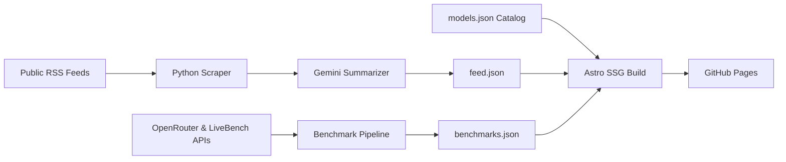

# AI Pulse

> A minimalist AI intelligence dashboard aggregating news, research, model releases, and benchmarks from verified public sources. Summaries generated with Google Gemini.

[](https://swaroophegde07.github.io/ai-pulse/)
[](https://github.com/swaroophegde07/ai-pulse)

* **Live Dashboard:** [https://swaroophegde07.github.io/ai-pulse/](https://swaroophegde07.github.io/ai-pulse/)
* **Repository:** [https://github.com/swaroophegde07/ai-pulse](https://github.com/swaroophegde07/ai-pulse)

---

## Overview

The artificial intelligence landscape moves faster than traditional news cycles. Tracking major foundation model releases, algorithmic breakthroughs, and benchmark evaluations across disparate company blogs and labs creates noise and fragmentation.

**AI Pulse** solves this by centralizing high-signal RSS feeds from frontier AI labs and reputable tech publications into a single, clean static dashboard. A lightweight Python pipeline ingests new articles twice daily, extracts content, filters duplicate or tracking parameters, and uses the official Google Gemini SDK to generate concise, objective 2–3 sentence summaries.

---

## Live Demo

Explore the live site at **[swaroophegde07.github.io/ai-pulse](https://swaroophegde07.github.io/ai-pulse/)**.

Visitors can:
* Read the latest curated AI industry developments and research findings.
* Search articles instantly by title, publisher, summary, or category.
* Filter coverage by topic: **News**, **Research**, **Benchmark**, **Product Release**, and **Opinion**.
* Explore the **Model Tracker** for frontier model architectures (GPT-4o, Claude 3.5/3.7, Gemini 2.0, Llama 3.3, DeepSeek-R1, Phi-4).
* Access the **Research Feed** directory of primary AI research labs and publications.
* Review the **Benchmark Board** tracking standardized evaluation suites (SWE-bench, Chatbot Arena, GPQA Diamond, MMLU-Pro).

---

## Features

* **Verified RSS Feeds**: Ingestion across primary labs and AI journalism outlets including OpenAI, Google DeepMind, Hugging Face, GitHub AI, VS Code, Microsoft Research, The Gradient, The Verge AI, and Ars Technica.
* **Factual AI Summaries**: Uses the official `google-genai` Python SDK to generate 2–3 sentence summaries. Built-in guardrails strip conversational filler, preserve source metadata, and fall back gracefully if an API call fails.
* **Client-Side Search & Filtering**: Fast, zero-latency in-browser search across titles, summaries, and publishers with dynamic category tabs and empty state handling.
* **Dedicated Intelligence Hubs**:
  * `/news/` — Complete, searchable chronological news archive.
  * `/models/` — Frontier foundation model landscape and model release tracking.
  * `/research/` — Research laboratory directory and technical publications feed.
  * `/benchmarks/` — Evaluation methodology reference and benchmark coverage.
* **Robust Data Pipeline**: Normalizes URLs, removes UTM tracking tags, generates stable SHA-256 IDs, prunes demo entries from production metrics, and writes JSON atomically.
* **Serverless & Database-Free**: Operates entirely with static site generation (Astro) and a Git-committed JSON datastore. No external database or persistent server required.

---

## How It Works



1. **Ingest News**: The Python ingestion script reads verified feeds from `src/data/sources.json`.
2. **Deduplicate & Clean**: URLs are canonicalized, fragments and UTM tracking queries are stripped, future dates are clamped, and existing articles are detected via deterministic IDs.
3. **Summarize**: New articles are passed to Google Gemini (`google-genai` SDK) to produce structured summaries and validate category tags. Merged into `src/data/feed.json`.
4. **Ingest Benchmarks**: The benchmark pipeline (`pipeline/benchmarks/runner.py`) fetches and validates multi-source evaluations (LiveBench monthly evaluations, OpenRouter pricing & context telemetry) and writes atomically to `src/data/benchmarks.json`.
5. **Catalog Models**: Frontier model architecture specs, release dates, open weights licenses, and pricing are curated in `src/data/models.json`.
6. **Build & Deploy**: Astro compiles the static HTML/CSS bundle into `dist/` and GitHub Actions deploys the site to GitHub Pages.

---

## Technology Stack

* **Frontend:** [Astro](https://astro.build/) (Static Site Generation), [TypeScript](https://www.typescriptlang.org/), [Tailwind CSS](https://tailwindcss.com/)
* **Pipeline:** [Python 3.10+](https://www.python.org/), [feedparser](https://github.com/kurtmckee/feedparser), [google-genai](https://github.com/google-gemini/deprecations) (Official Google GenAI SDK)
* **Automation:** [GitHub Actions](https://github.com/features/actions) (Scheduled cron + manual workflow dispatch)
* **Hosting:** [GitHub Pages](https://pages.github.com/)
* **Testing:** [pytest](https://docs.pytest.org/), [pytest-cov](https://pytest-cov.readthedocs.io/), `astro check`

---

## Local Setup

### Prerequisites

* **Node.js** 18.17.1+ or 20+
* **Python** 3.10+
* **Google AI Studio API Key**: Required only for running the Gemini summarizer locally ([Get a free key](https://aistudio.google.com/app/apikey))

### 1. Clone the Repository

```bash
git clone https://github.com/swaroophegde07/ai-pulse.git
cd ai-pulse
```

### 2. Configure Environment Variables

```bash
cp .env.example .env
```

Edit `.env` and provide your Gemini API key:

```env
GEMINI_API_KEY=your_gemini_api_key_here
GEMINI_MODEL=gemini-2.5-flash
```

*(Note: The frontend runs without an API key because it reads pre-built data from `src/data/feed.json`.)*

### 3. Install Dependencies

Install Node.js dependencies:
```bash
npm install
```

Install Python dependencies:
```bash
pip install -r requirements-dev.txt
```

### 4. Run the Ingestion Pipeline (Optional)

To ingest fresh RSS items and generate summaries locally:

```bash
python -m pipeline.run
```

### 5. Start the Development Server

```bash
npm run dev
```

Open [http://localhost:4321](http://localhost:4321) in your browser.

To verify the production build locally:

```bash
npm run build
npm run preview
```

---

## Running Tests

Unit tests mock the Gemini API and do not require network access or a live API key.

```bash
# Run Python pipeline tests
python -m pytest pipeline/tests/ -v

# Run Astro type check
npm run check

# Run production build validation
npm run build
```

---

## Automated Updates

The project uses a GitHub Actions workflow defined in [`.github/workflows/update-and-deploy.yml`](.github/workflows/update-and-deploy.yml).

* **Twice-Daily Schedule:** Runs at `07:00 UTC` and `19:00 UTC` daily.
* **Manual Dispatch:** Can be triggered on demand via **Actions → Update and Deploy → Run workflow**.
* **Deployment Pipeline:**
  1. Runs pipeline test suite (`pytest`).
  2. Runs `python -m pipeline.run` with repository secret `GEMINI_API_KEY`.
  3. Commits updated `src/data/feed.json` using `[skip ci]` to prevent recursive workflow triggers.
  4. Runs `npm run check` and `npm run build`.
  5. Deploys the static `dist/` directory to GitHub Pages via `actions/deploy-pages`.

---

## Project Structure

```text
ai-pulse/
├── .github/workflows/
│   └── update-and-deploy.yml    # Ingestion, build, and deployment workflow
├── pipeline/
│   ├── run.py                   # Unified pipeline orchestrator entry point
│   ├── scraper.py               # Feed parsing, URL normalization & deduplication
│   ├── sources.py               # Source registry & category configuration
│   ├── summarizer.py            # Gemini SDK summarization & fallback validation
│   ├── benchmarks/              # Multi-source benchmark & telemetry subsystem
│   │   ├── base.py              # Schema validation & SourceAdapter interface
│   │   ├── runner.py            # Benchmark execution orchestrator
│   │   └── adapters/            # Adapters (OpenRouter, LiveBench, BenchLM, etc.)
│   ├── requirements.txt         # Production Python dependencies
│   └── tests/
│       └── test_pipeline.py     # Unit test suite (82 passing tests)
├── src/
│   ├── components/              # Header, Footer, NewsCard, CategoryFilter
│   ├── data/
│   │   ├── feed.json            # Ingested article datastore
│   │   ├── sources.json         # Configured RSS feed list
│   │   ├── models.json          # Frontier model catalog & architecture specs
│   │   └── benchmarks.json      # Evaluated benchmarks & OpenRouter telemetry
│   ├── layouts/
│   │   └── Layout.astro         # HTML document shell
│   └── pages/
│       ├── index.astro          # Dashboard homepage
│       ├── news/index.astro     # Searchable news archive
│       ├── models/index.astro   # Frontier model landscape & release tracker
│       ├── research/index.astro # Research lab directory & publication feed
│       └── benchmarks/index.astro # Evaluation board & head-to-head comparison
├── astro.config.mjs             # Astro SSG configuration
├── tailwind.config.mjs          # Tailwind CSS styling config
└── requirements-dev.txt         # Dev & test Python dependencies
```

---

## Project Status & Roadmap

### Implemented & Live
- [x] Automated RSS feed ingestion across 9 verified providers with future-date clamping and UTC normalization.
- [x] Objective Gemini-powered article summarization with graceful fallback handling.
- [x] In-browser search across headlines, publishers, and summaries with category filtering.
- [x] Structured Frontier Model Catalog (`src/data/models.json`) with context windows, pricing, modalities, and open-weights licensing.
- [x] Multi-Source Benchmark & Intelligence Dashboard (`/benchmarks/`) with category filters and interactive head-to-head model comparison.
- [x] Automated OpenRouter API telemetry integration (pricing, context limits) and LiveBench monthly evaluation benchmark ingestion.
- [x] Adapter architecture with transparent licensing and provenance governance (handling BenchLM CC BY-NC 4.0, Artificial Analysis API requirements, and LMCouncil guidelines).
- [x] Curated Research Lab Directory (`/research/`) with deterministic keyword classification and active lab statistics.
- [x] Scheduled GitHub Actions workflow staging both `feed.json` and `benchmarks.json`.
- [x] Comprehensive test suite (82 passing unit tests covering feeds, summarizer, benchmarks, and model catalogs).

### Planned Features
- [ ] Direct arXiv `cs.AI` and `cs.LG` automated daily preprint clustering.
- [ ] Semantic vector search over historical articles using Gemini embeddings.
- [ ] Optional daily email digest dispatch.

---

## Contributing

Contributions, feedback, and feed suggestions are welcome.

When adding new RSS sources to `src/data/sources.json` or `pipeline/sources.py`:
1. Ensure the feed is publicly accessible without authentication or paywalls.
2. Verify that the URL returns valid RSS or Atom XML.
3. Ensure all tests continue to pass (`pytest pipeline/tests/ -v` and `npm run check`).

Submit changes by creating a branch and opening a pull request.

---

## License

No license has been specified for this repository yet. All rights are reserved by the repository owner unless otherwise stated.
